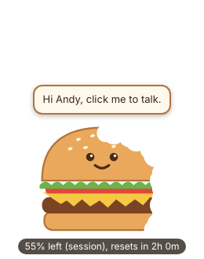

# Usage burger



A burger that floats on top of everything on your screen. It gets bitten as your Claude plan usage runs down, and you can talk to it: click it (or press Ctrl+Alt+Space), say something, and it passes what you said to your AI agent and reads the answer back out loud.

This is the `burger` branch of [usage-sandwich](https://github.com/AndySoMeta/usage-sandwich), forked from the sandwich mod. The sandwich stays on `main`; the burger is its own app with its own small mod.

It has two parts:

- **The app** (`app/`): the floating burger. Windows for voice; it also runs on Mac and Linux, where you type instead.
- **The mod** (`mod/`): a small Claude Code mod that sends your plan usage to the burger after each Claude reply. Without it the burger still talks, it just doesn't know how much is left.

## Set it up (Windows)

1. Install [Node.js](https://nodejs.org) (version 20 or newer) if it isn't on the PC yet.
2. Get the code and start the burger:

   ```
   git clone -b burger https://github.com/AndySoMeta/usage-sandwich.git usage-burger
   cd usage-burger\app
   npm install
   npm start
   ```

3. Add the mod in Claude desktop: click + next to the prompt box, then Plugins, then Add marketplace with `AndySoMeta/usage-sandwich` (skip that if you already added it for the sandwich), then add the usage-burger plugin. From a terminal instead:

   ```
   claude plugin install usage-burger --marketplace AndySoMeta/usage-sandwich
   ```

## Using it

- **Talk:** click the burger, or press Ctrl+Alt+Space from anywhere. It glows blue while it listens.
- **Type:** double-click the burger.
- **Move it:** drag it anywhere. It remembers where you left it.
- **More:** right-click for your usage numbers, a fresh conversation, hiding the words, the settings file and Quit.

The burger keeps one conversation going, so you can follow up ("and what about tomorrow?"). Right-click and pick Start a new conversation to clear it.

## Which agent it talks to

Right-click, Open settings file, and change:

- `"agent": "claude-code"` (the default) runs Claude Code on this computer in the folder named by `agentFolder`. Claude Code keeps its own permission rules. It can't stop to ask you while you're talking to the burger, so anything that would normally ask you first doesn't happen.
- `"agent": "http"` sends what you said to any agent with a web address, such as Hermes or your own bot. Set `agentUrl`. The burger POSTs `{ "text": "...", "conversation": "..." }` and expects `{ "reply": "...", "conversation": "..." }` back.

`hotkey` and `speakReplies` live in the same file. Restart the burger after changing it.

## Good to know

- Voice uses the speech recognition built into Windows: nothing to download, no account and no cost. Answers are read out with Windows' own voices.
- Talking to Claude Code through the burger uses your Claude plan, the same as typing to it. You'll see the bites.
- The usage numbers come in while Claude Code sessions run. The mod posts them to `127.0.0.1:47823`, which only this computer can reach; the burger turns away anything sent from a web page.

## Tests

```
cd app
npm test
```

and for the mod, `claude plugin test mod`.
